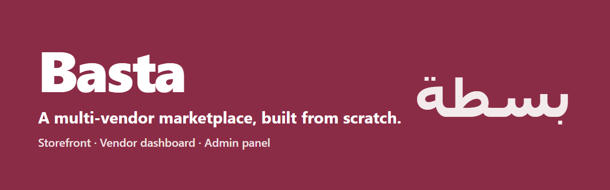
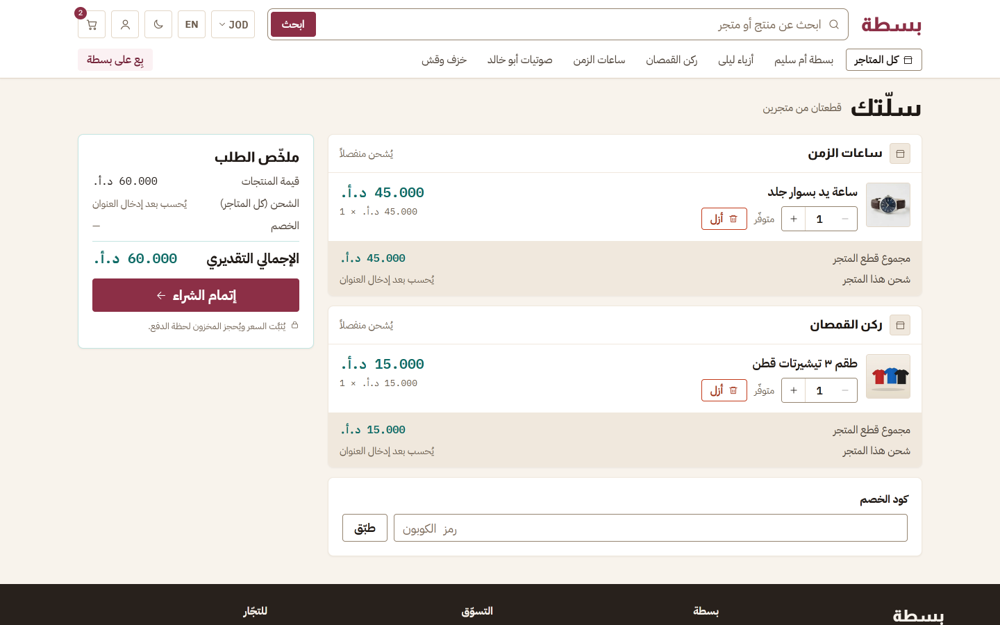
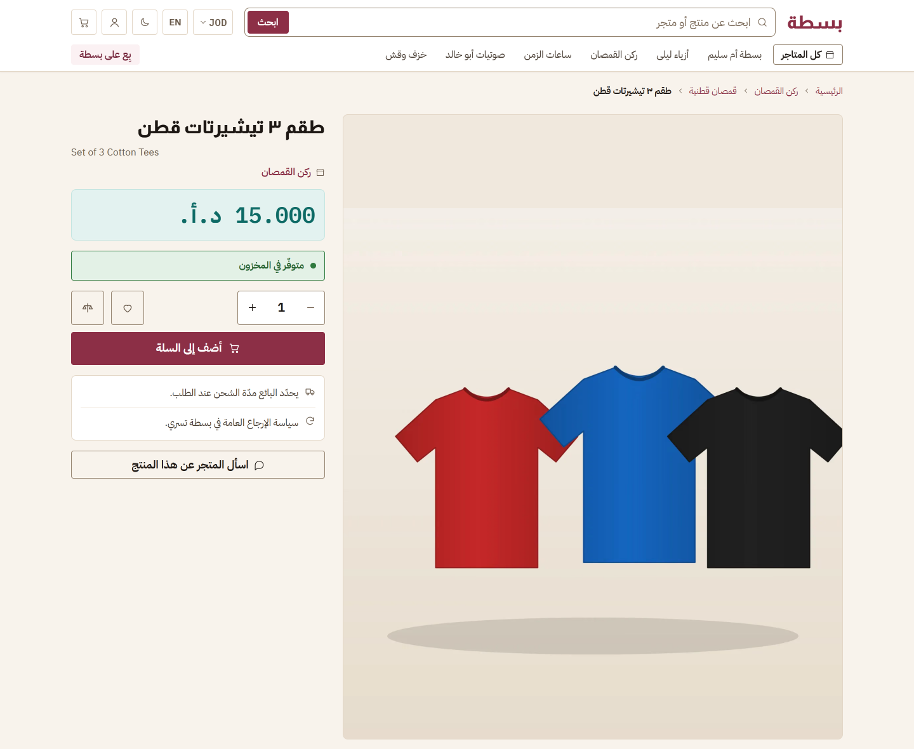
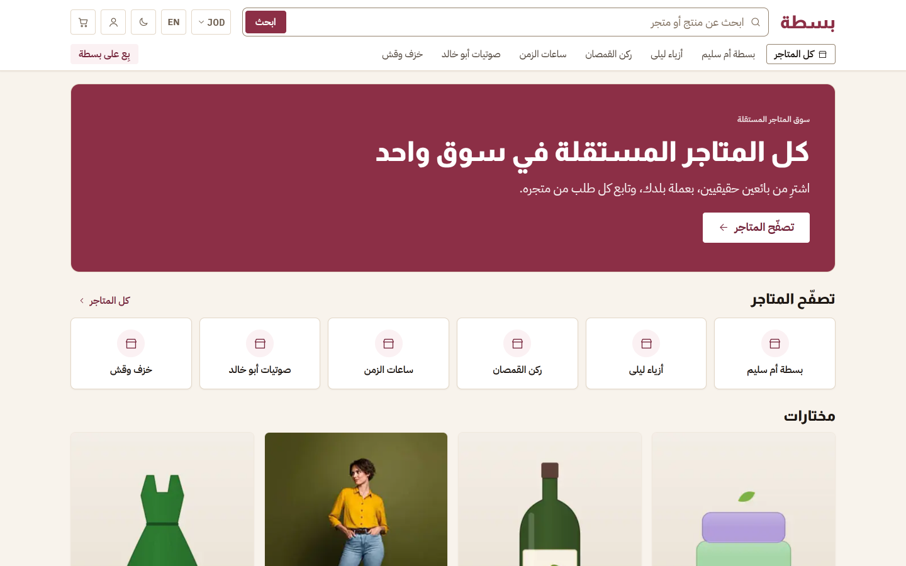
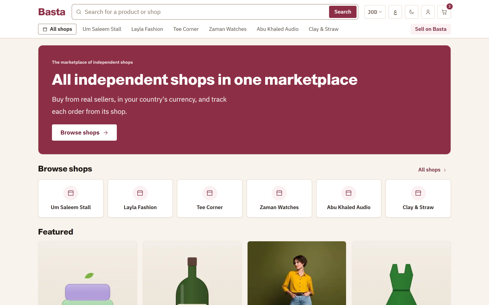

<p align="center">
  
</p>

<p align="center">
  
  
  
  
  
  
  
  
</p>

A full multi-vendor marketplace built from scratch: a customer storefront, an independent dashboard for every vendor, and a central admin panel with a commission and settlement engine.

> [!NOTE]
> **Personal project** by Marwa Samsoum — designed, planned and built end to end.
> **This repository holds the web frontend.** The backend (API, database and business logic) lives in a private repository — available on request.
> **Status:** feature-complete and fully tested locally; not deployed yet.

## Highlights

- **86 screens** across the storefront, the vendor dashboard and the admin panel.
- **Multi-vendor cart** — one customer order is split automatically into a sub-order per vendor, each with its own shipping and status.
- **Reliable money handling** (backend)
  - All amounts are stored as integers (no floating-point rounding errors).
  - The commission rate is snapshotted on each order at purchase time (vendor rate → global rate), so later changes never rewrite the past.
  - An append-only ledger: entries are never edited or deleted; corrections are new entries.
- **Vendor data isolation** enforced in the API, not just hidden in the UI.
- **Bilingual Arabic / English** — built right-to-left first; every page, notification and email follows the user's language.
- **Arabic-aware search** (Meilisearch) that ignores hamza forms, ta marbuta / ha, alif maqsura / ya, diacritics and Arabic-Indic digits.
- **Light and dark themes**, multi-currency prices, and an installable PWA.

## Screenshots

<table>
  <tr>
    <td width="50%"><br><b>Multi-vendor cart</b> — one order, two shops, each with its own shipping and total.</td>
    <td width="50%"><br><b>Product page</b> — shopper's currency, live stock and a direct line to the shop.</td>
  </tr>
  <tr>
    <td width="50%"><br><b>Arabic first</b> — built right-to-left from day one.</td>
    <td width="50%"><br><b>Fully bilingual</b> — one click and everything follows the language.</td>
  </tr>
</table>

## Tech stack

| Layer | Tools |
|---|---|
| **Frontend (this repo)** | Next.js 16 (App Router), React 19, TypeScript, TanStack Query, Zustand, Sentry |
| Backend *(private)* | NestJS, TypeScript, 19 domain modules (catalog, cart, checkout, orders, finance, payments, shipping, …) |
| Data *(private)* | PostgreSQL, Prisma |
| Search *(private)* | Meilisearch |
| Background jobs *(private)* | In-process schedulers over PostgreSQL (stock-reservation expiry, payment reconciliation, notification delivery) |
| Testing | Vitest (API, unit + integration), Playwright (end-to-end) |

## Quality

- **546 documented test cases**, tracked in a QA workbook.
- **~90 API test files** (unit + integration, on a dedicated test database) and **110+ end-to-end test files**.

## Planning

Before writing any code, I planned the project as if it were a real client engagement: a technical and financial proposal (scope, screens, timeline and a cost estimate — a planning exercise for my own project, not a client contract), a 12-phase execution plan with a testable exit gate per phase, architecture decision records, a data model and order/payment state machines. These live in the private repository — available on request.

## Running the frontend

Requires Node.js 22+ and a running Basta API (private).

```bash
cp .env.example .env.local   # set NEXT_PUBLIC_API_URL to the API address
npm install
npm run dev                  # http://localhost:3000
```

---

<p align="center"><b>Marwa Samsoum</b> · Full-Stack Developer · open to Full-Stack roles, remote or in the region</p>
